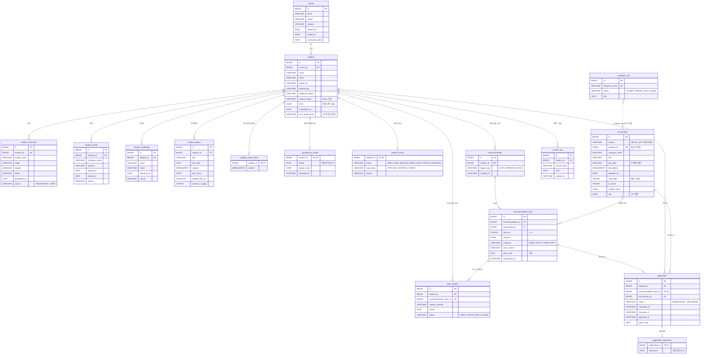

# 이음 P0 ERD

`db/schema.sql` 기준입니다. GitHub에서 이 파일을 열면 다이어그램으로 보입니다. 스키마가 바뀌면 BE-B가 이 파일도 함께 고칩니다.

## 테이블별 주인과 쓰는 쪽

| 테이블 | 만드는 쪽 (쓰기) | 읽는 쪽 | 화면 |
| --- | --- | --- | --- |
| course, student, student_education, student_career, student_certificate, student_project, student_cover_letter | BE-B (시드 · 프로필 수정) | BE-A, AI | M6, M8, C2, C3 |
| competency_profile | BE-B (AI-B 추출 결과 저장) | BE-A, C3 | M8, C3 |
| job_posting | BE-A (일 배치) | AI-B 색인 | M1, M2 |
| company_info | BE-A (AI-B 수집 결과 저장) | AI-A 서류 생성 | M5, M6-1 |
| recommendation, recommendation_item | BE-A | BE-B 상태 판정 | M1, M2, M3, M7, C3 |
| help_request | BE-B | - | M4, C1 |
| application | BE-A 생성 · 제출 / BE-B 승인 · 반려 · 전달 | 둘 다 | M5, M6, M7, C1, C4 |
| application_document | BE-A (AI-A 생성 결과 저장 · 수정) | BE-B | M6, M6-1, M6-2, C4 |
| student_status | BE-B (규칙 계산) | - | C1, C2, C3 |
| contact_log | BE-B | - | C1, C3 |

`company_info`와 `job_posting`은 외래키 없이 `company_name`으로 연결합니다. 공고 API의 기업명 표기가 일정하지 않을 수 있어서, 시연 기업만 수집해 두는 P0에서는 이름 일치로 충분합니다.
