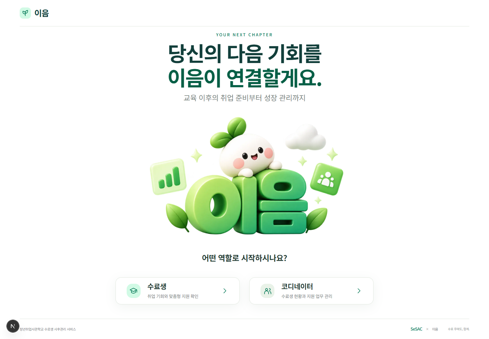
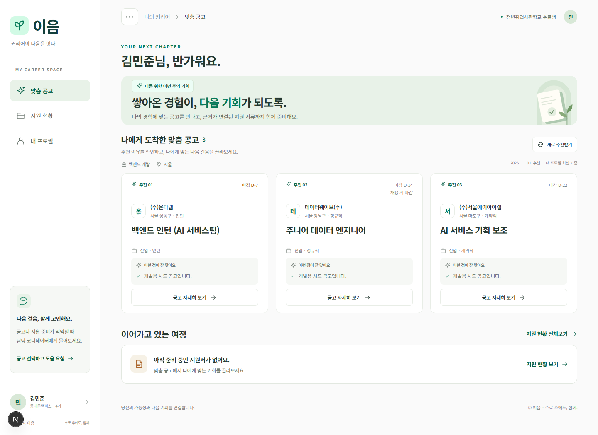
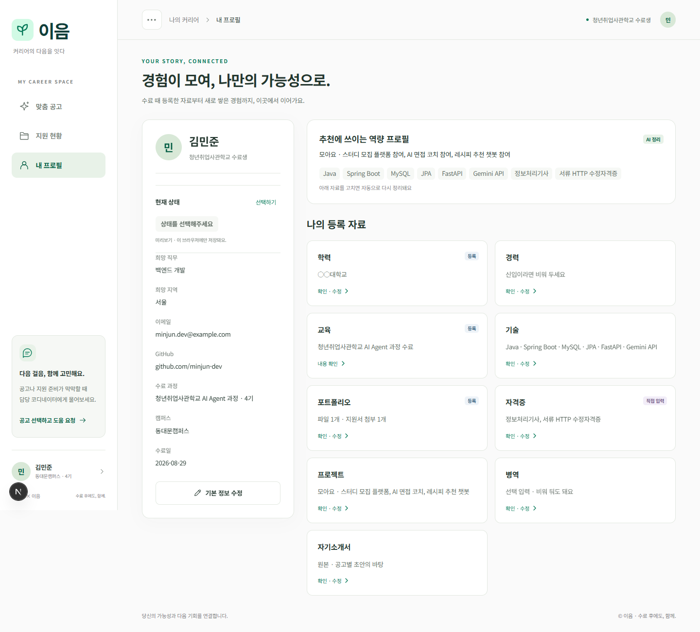
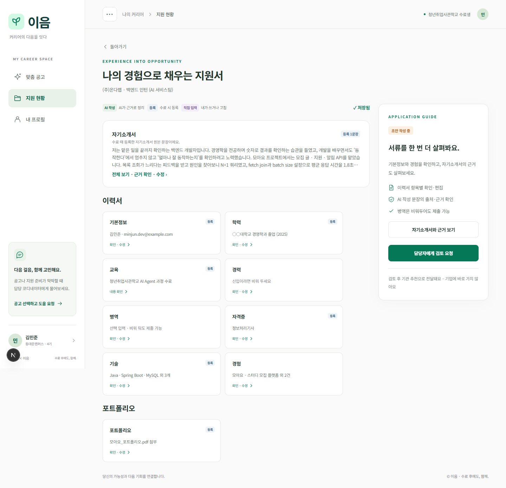

# R0·수료생 웹 화면 변경 및 요구사항 점검

작성: 2026-11-01. 파트: FE-A. 범위: R0, M1~M8. PR base: `dev`.

## 최신 dev 통합

- 통합 기준: `origin/dev`의 `af58ab5` (PR #94 포함).
- 기존 기준 `2191307` 이후 dev 변경은 AI 평가·매칭 파일 22개다. 이번 FE 변경과 겹치는 파일이 없어 기능 브랜치에 fast-forward로 반영했다. 충돌 파일은 없다.
- 통합 전에 수정·미추적 파일 42개와 바이너리 diff를 저장소 밖에 백업했다. 이전 stash도 유지했다.
- 통합 후 린트에서 발견한 초기화·훅 의존성을 정리했다. 최종 요청에 따라 비율 조절 개발 도구는 제거하고 확정된 반응형 배치를 적용한다.
- `main`·`dev`에는 직접 커밋하거나 push하지 않는다.

## 사용자 요청의 최종 반영 상태

| 화면 | 반영 내용 |
| --- | --- |
| R0 역할 선택 | 큰 화면에 맞는 세로 흐름, 새싹 캐릭터 이미지, 수료생·코디네이터 역할 선택. 역할 카드 비율과 글씨 크기를 조정한 최종 디자인 반영 |
| R0 ID 입력 | 수료생 버튼을 누르면 배경 배치를 바꾸지 않는 모달. ID 확인, 입력 오류, 중복 제출 방지, Esc·배경 클릭·초점 복원, ID를 모를 때 안내 유지 |
| R0 장식 | 상단 이용안내 버튼 제거, 브랜드의 마침표 제거, 로고·하단 문구 축소. 별도 계정·비밀번호 로그인은 추가하지 않음 |
| 공통 셸 | 수료생 사이드바, 상단 경로·사용자 표시, 모바일 하단 메뉴, `…` 버튼으로 사이드바 접기·펼치기. 로그인 페이지와 같은 새싹 로고 |
| 화면 비율 | 큰 모니터의 가용 폭 사용과 글씨·아이콘 확대, 태블릿·모바일 재배치. 기존 API 호출과 studentId 이동 유지 |
| M1 배치 | 커리어 프로필 요약 카드 제거, 낮고 넓은 배너, 설명을 제목 바로 아래 왼쪽 정렬. 기본 비율에서 데스크톱 공고 3장 전체 표시 |
| M1 스타일 | 사용자가 선택한 공고 제목·필터·카드 영역만 새 스타일. 인사말·배너·지원 여정은 이전 디자인 유지. 비교용 전체 새 스타일은 제거 |
| M1 버튼 | 공고 자세히 보기 기본색 통일, 버튼 hover·키보드 초점 시 초록색. 첫 번째 공고만 채우던 강조 제거 |
| M1 확정 비율 | 화면 비율 조절 버튼·패널·슬라이더·설정 복사 제거. 기존 확정 비율로 표시하며 과거 URL·브라우저의 조절 설정은 적용하지 않음 |
| M2~M4 | 공고 조건·추천 근거·요약, 기존 6종 PASS 사유, 도움 요청 생성과 선택 연락 방법·메모 수정 유지 |
| M5 | 지원 클릭 즉시 `지원서를 작성중입니다. 잠시만 기다려주세요` 표시. 클릭부터 최소 5초 뒤 실제 DRAFT에서 이동. 더 오래 생성하면 완료까지 기다림. 기존 2초 진행 조회·실패 재확인 유지 |
| M6 | 자기소개서 미리보기를 이력서 위에 배치. 이력서 항목 카드는 가로·세로 비율을 유지하며 기본 대비 10% 축소. 항목별 편집·프로필 동시 저장·검토 요청 유지 |
| M6-1 | 웹에서 문장과 근거·편집 영역을 나란히, 모바일에서는 위아래로 표시. 출처·기업 정보 제한 안내·문장 PATCH·직접 입력 전환 유지 |
| M7 | 지원서 상태 필터·진행 단계·다른 공고 응답, 5초/복귀 재조회 유지. 제출 이후 서류는 읽기 전용 |
| M8 등록 자료 | 1행 학력·경력, 2행 교육·기술, 3행 포트폴리오·자격증, 4행 프로젝트·병역, 5행 자기소개서. 기본정보는 왼쪽 요약에서 편집 |
| M8 현재 상태 | 이름 아래 구직 중·취업 완료·취업 준비 중·잠시 쉬는 중 선택. 학생별 브라우저 미리보기 저장이며 서버 자동 상태와 구분 |
| 페이지 배경 | 페이지 바탕만 흰색·연한 중립색으로 조정. 로고·배너·선택 메뉴·배지 등 요소의 기존 민트·초록색은 복원·유지 |
| 응답 취소 | APPLY·PASS·HELP에 취소 버튼·확인창·중복 방지·실패 유지·성공 후 NONE 복원 준비. 실제 DELETE 서버 구현은 별도 |

## 유지·개선한 기존 요구사항 ID

문서의 기존 FE-B ID는 변경하지 않았다. 최신 AGENTS.md에서는 수료생 화면과 공용 서류 부품의 담당이 FE-A다.

| 요구사항 | 이 PR의 대응 |
| --- | --- |
| FE-A-01 | 버튼·태그·카드·모달의 수료생 테마와 접근성 |
| FE-A-02 | R0 역할 선택·수료생 ID 확인·경로 유지 |
| FE-A-03, FE-A-04, FE-A-05 | 추천 3장·추천 갱신·응답 배지 |
| FE-A-06, FE-A-07, FE-A-08, FE-A-09, FE-A-10 | 상세·지원·도움 요청·PASS·연락 정보 |
| FE-A-11 | 진행 단계 조회·생성 실패·DRAFT 전환, 최소 5초 표시 추가 |
| FE-A-12, FE-A-13 | 지원 현황·3탭 이동·응답 상태 갱신 |
| FE-B-01, FE-B-02, FE-B-03 | 서류 출처·섹션 카드·검토 요청 |
| FE-B-04, FE-B-05 | 자기소개서 근거·문장 수정·항목 편집·프로필 동시 저장 |
| FE-B-06 | 프로필·역량 반영·등록 자료 편집 |

응답 취소와 직접 선택 상태는 기존 요구사항 완료로 간주하지 않는다. 아래 신규 기획에 FE 구현 범위와 미구현 서버 작업을 구분했다.

## 기존 API 대응 — 변경 없이 재사용

| 메서드·경로 | 함수·기능 |
| --- | --- |
| GET `/api/students/{studentId}/recommendations/current` | getCurrentRecommendations |
| POST `/api/students/{studentId}/recommendations/refresh` | refreshRecommendations |
| GET `/api/recommendation-items/{itemId}` | getRecommendationItem |
| POST `/api/recommendation-items/{itemId}/response` | respondToItem: APPLY·PASS |
| POST `/api/help-requests` | createHelpRequest |
| PATCH `/api/help-requests/{helpRequestId}` | updateHelpRequest |
| GET `/api/applications/{applicationId}/progress` | getApplicationProgress |
| GET `/api/applications/{applicationId}` | getApplication |
| PATCH `/api/applications/{applicationId}/document` | patchDocument: ADD_ITEM·UPDATE_ITEM·DELETE_ITEM·UPDATE_SENTENCE |
| POST `/api/applications/{applicationId}/submit` | submitApplication |
| GET `/api/students/{studentId}/applications` | getStudentApplications |
| GET `/api/students/{studentId}/profile` | getProfile·getStudentName |
| POST `/api/students/{studentId}/profile/items` | addProfileItem |
| PATCH `/api/students/{studentId}/profile/items/{itemId}` | updateProfileItem |
| DELETE `/api/students/{studentId}/profile/items/{itemId}?section=` | deleteProfileItem |
| PUT `/api/students/{studentId}/cover-letter` | updateCoverLetter |

## 서버 미연동 기능과 한계

- **취소는 FE·API 요청 명세만 준비**했다. 신규 제안 `DELETE /api/recommendation-items/{itemId}/response?expectedResponse=APPLY|PASS|HELP`는 기존 백엔드에 없다. 실제 모드에서는 서버 성공을 확인하지 못하면 상태를 바꾸지 않는다. 목업 모드에서는 학생별 기록과 세션 캐시를 정리하고 재지원 시 새 지원서 번호를 쓴다. [취소 기획·API·보호 상태·도움 요청 정책](RESPONSE_CANCEL_PLAN.md).
- **직접 선택 현재 상태는 이 브라우저에만 저장**한다. 자동 판정 StudentStatus, 추천, 도움 요청, 담당자 집계는 변경하지 않는다. UI에도 미리보기 범위를 표시한다. [현재 상태 기획·GET/PATCH 제안](PROFILE_CURRENT_STATUS_PLAN.md).
- 등록 파일 선택·실제 업로드/다운로드·별도 인증·새 AI 호출·Vercel 배포는 이번 PR에 추가하지 않는다.
- 확정 비율에서 데스크톱 공고 3장 표시를 검증했다. 화면 크기에 따라 반응형 배치를 적용한다.
- 로컬 실제 BE 검증은 기존 데이터의 GET만 사용했으며 AI_MOCK=true다. 외부 AI 품질과 취소 백엔드 통합은 검증 대상이 아니다.

## 검증

- `npm run lint`: 오류·경고 없음.
- `npx tsc --noEmit`: 통과.
- `npm run build`: 실제 API 모드로 전체 라우트 프로덕션 빌드 통과.
- 기존 HTTP 목업·시드 회귀: 18개 테스트 통과.
- 신규 `response-cancel.test.mjs`: 5개 테스트 통과. 학생·공고 격리, 보호 상태 거절, 취소 캐시 복원, HELP 재요청, 재지원 새 ID, 실제 모드 요청·결과 검증.
- 브라우저 전체 흐름: 검증 27개 통과. 메모리 HTTP 목업에 16개 API 조합과 서류 PATCH 4종을 실제 전송하고 런타임 오류가 없음을 확인했다. 실제 DB 쓰기는 하지 않았다.
- 추가 브라우저 검증: R0 배경 고정 모달·입력 검증·초점·안내·Esc, 실제 BE GET 연결, 최소 5초 로딩, HELP 취소 성공·거절, 현재 상태 4종·복원·저장 실패·학생 분리, 비율 조절 UI 제거·과거 설정 무시, 공고 영역 스타일 적용 범위.
- 화면 범위: 320/390/768/1024/1366/1440/1920/2560/3413px. 기본 비율에서 1366×768 이상 주요 데스크톱 화면의 공고 3장과 모바일 편집창·가로 넘침을 확인했다.
- `git diff --check`: 통과. BE·DB·AI·코디네이터 소스·의존성·기존 API 명세(`docs/API.md`)의 이 PR 변경 없음.

재현 가능한 저장소 내 테스트:

```powershell
cd frontend
npm run lint
npx tsc --noEmit
npm run build
node --test src/components/student/response-cancel.test.mjs src/components/student/dev-mock/server.test.mjs src/components/student/dev-mock/seed.test.mjs
```

브라우저 수동 확인: ID 확인 → 맞춤 공고 → 상세 → 지원/진행 → 항목·문장 편집 → 검토 요청 → 읽기 전용 확인. PASS·도움 요청·연락 메모·프로필 CRUD·자기소개서 원본 저장도 각각 확인한다. 취소 성공 검증은 테스트 응답이나 목업을 쓰고, 실제 서버 미지원 시에는 오류 뒤 응답이 유지되는지 확인한다. 비율 조절 버튼·패널이 없는지 확인하고, 현재 상태는 적용/닫기·새로고침·다른 학생 ID로 분리되는지 확인한다.

## 공용 파일·커밋 범위

- 공용 수정: `components/ui/BottomSheet.tsx`, `components/resume/`, `styles/tokens.css`, `lib/api/student.ts`, `types/student.ts`. 소유자 FE-A이며 수료생 전체 수정은 사용자에게 승인받았다. 서류 부품의 기존 기능·props와 코디네이터 사용은 유지했다. 새 스타일은 `.entry-app`·`.student-app` 안에서 적용한다.
- `.env`, API 키, 의존성, DB 스키마, 실제 개인 데이터는 포함하지 않는다.
- 기존 미추적 로컬 자료 `frontend/AGENTS.md`, 사용하지 않는 `public/images/r0-background.png`, `dev-mock/LOCAL_WORK_NOTES.md`는 보존하고 커밋에서 제외한다.
- 아래 캡처는 메모리 HTTP 목업의 모의 데이터다. R0 캐릭터는 사용자와 확정한 이미지 자산이다.

## 검토용 화면








